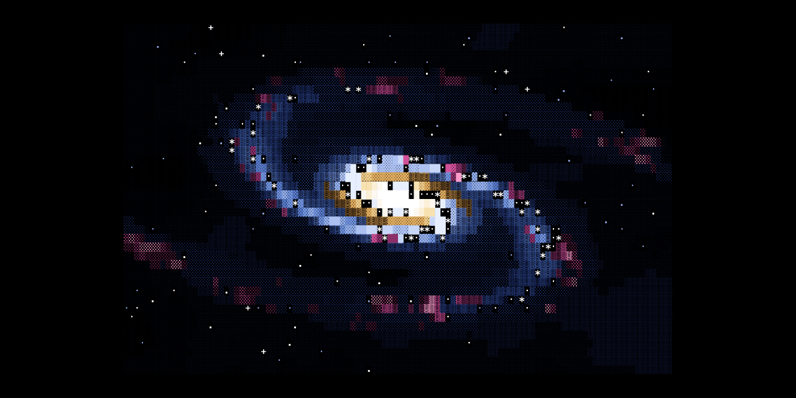

  

---

---

## 🌌 About Me

Hello, I'm Kanishka, a final-year Computer Engineering student (Honors in Cybersecurity) who builds full-stack and AI-powered products and designs them too. I enjoy turning messy, real-world problems into working software, from RAG-based assistants to fraud detection systems. Outside code, I do freelance graphic design and video editing.

---

## ⚙️ Tech Stack

**Languages**

**Frameworks & Libraries**

**Databases & Cloud**

**AI / ML**

**Tools & DevOps**

---

## 🛰️ Projects

| Project | Stack | Highlights |
|---|---|---|
| **[IntelliCampus](https://github.com/RayyanKimoi/IntelliCampus)** | Next.js, TypeScript, PostgreSQL, Pinecone, Redis | RAG tutoring pipeline, semantic cache, adaptive quizzes, multi-role API |
| **[Abuse-Ring-Sentinel](https://github.com/kanik10/Abuse-Ring-Sentinel)** | Python, NetworkX, scikit-learn, Streamlit, D3.js, ReportLab, Docker | Graph-native fraud syndicate detection (Louvain + referral-cycle features), 100% precision/recall on 28 planted rings, 90.4% of fraud volume intercepted pre-clearance via zero-lookahead temporal backtest, SHAP explainability, SHA-256 hash-chained audit log |

---

## ⭐ Statistics

---

  

  <i>"Building systems that bridge ML research and production engineering — one commit at a time. 🚀"</i>

